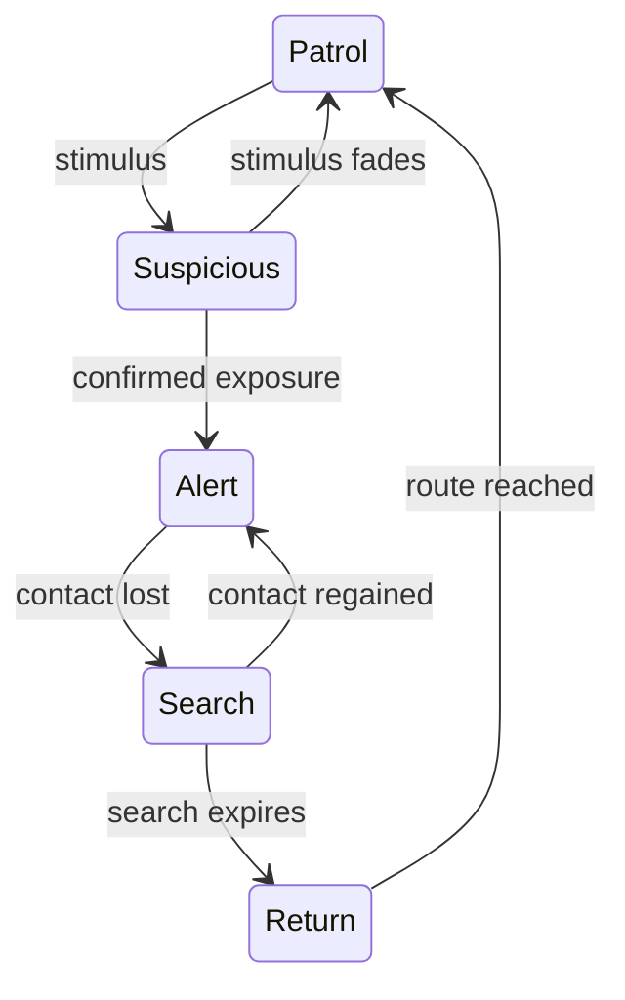

# Bearframe game design research and production reference

**Ghost Signal Expanded and Aeon Circuit: The Silent Wake**  
November 17, 2026 · Atlas Warehouse research · Spoiler-free

## Start here

| If you're working on… | Start with… | Evidence to bring back |
|---|---|---|
| A level, world region or dungeon | [01 · World and maps](#01--world-and-maps), then the relevant game chapter | Annotated routes and state graph, sightline and collision checks, real gameplay frames at matching positions |
| Ghost Signal enemies, mission flow or difficulty | [02 · Ghost Signal](#02--ghost-signal) | Sightline explanation, reaction/recovery timings, route traces, cold and experienced player observations |
| Aeon enemies, parties, progression or economy | [03 · Aeon Circuit](#03--aeon-circuit) | Reproducible turns and expedition ledger, difficulty by loadout and skill band, observed player decisions |
| An objective, cutscene, NPC, dialogue or quest | [04 · Narrative, events and cinematics](#04--narrative-events-and-cinematics) | State transitions, equivalent skip path, save/reload and consequence proof |
| Art, animation, interface, sound or accessibility | [05 · Presentation and accessibility](#05--presentation-and-accessibility) | Native-scale footage with HUD, effects and controls active, muted/reduced-effects checks |
| Engine integration, Android, testing or release | [06 · Engineering and verification](#06--engineering-and-verification) | Build fingerprint, reproducible scenarios, actual hardware and approval status |
| Production planning, templates or a research follow-up | [07 · Authoring cards and experiments](#07--authoring-cards-and-experiments), [08 · Evidence catalog](#08--evidence-catalog) | One hypothesis or decision per record, linked source, result and limitations |

**Identity and priorities.** Ghost Signal Expanded is the standalone Wraith game. Preserve the original M01/M02, its interaction/UI language and its stealth feel. The handoff puts M03–M06 visual and playable quality first. Aeon Circuit is a separate original sci-fi JRPG using the Ghost Signal engine. Its protagonist is an ancient Sleeper. The Silent Wake uses four-cardinal field art, connected exploration, selected stealth situations and side-view turn-based party combat. The current art production reference is a single noncanonical QA location (A20), pending visual acceptance. These priorities come from the respective project handoffs. Example maps, enemy values and scene fixtures below are research proposals. Private narrative, dialogue, art and asset files are excluded from this public reference.

**Evidence.** Public books, technical documentation, developer descriptions, selected slides and GDC abstracts inform the methods. An abstract indicates what the presentation covers. The source catalog distinguishes it from published guidance and actual game-design descriptions. Local archive inspection verifies the named package contents and permission notices summarized here. The worked examples are reproducible arithmetic and paper designs. No production gameplay, device test, asset import, canon change or release is asserted here. Links to adjacent studies are collected in [08](#08--evidence-catalog).

## 01 · World and maps

### Work from the world down to the screen

1. **Region network.** Draw destinations as nodes. Each edge identifies a physical connection, its direction, travel and return costs, a gate plus its cause, and the arrival landmark. Record the earliest knowledge and capabilities that make each edge intelligible. For a one-way trip, write where the player recovers, saves, resupplies or exits. For Aeon, record connections in both directions where applicable, including the intended spawn side and a nearby backtrack shortcut. Ghost Signal's mission objective stages can use the same graph format inside a bounded mission.
2. **Place program.** For each site identify builder or user, original job, supply and service circulation, utilities, present occupants, damage chronology, and which facts remain ambiguous. Follow a real task through the architecture. A field crew arrives, unloads gear, checks in, receives an assignment, works outdoors and returns. Loading, briefing and power should visibly serve those activities. An abandoned site should still have traces of its former function, with active and disused systems readable on the same screen.
3. **Experience and route graph.** Write what players will decide and what changes when they act. Mark spawn, early orientation, first decision, pressure peak, recovery, callback and exit. Draw mandatory and elective routes. A branch earns space through a different risk, a discovery, a tactical alternative, or a return connection. Annotate distances, approach directions, visibility and temporary states. Use the graph to remove redundant corridors and check whether converging paths preserve consequences.
4. **Blockout.** Walk the real movement footprint through grayboxed turns, intersections, doors and approach tiles. Capture the internal camera near every choice. Test sightlines from spawn, entry and the slowest approach. Verify that camera clamping doesn't hide the turn or make an interactable appear reachable through a solid wall. Give irreversible exits an explicit decision point. Prefer physical direction cues before adding a UI prompt.
5. **Composition and layering.** Give each visible region a strong silhouette or large material boundary, recognizable groups of mid-sized objects, and restrained surface detail. Paths and connections must read while moving. Use 32×32 map cells. Preserve source-sized props, depth pivots and wall-face heights separately from collision footprints. Reserve approach and swept volumes before baking scenery. The documented 480×270 internal viewport covers about 15 by 8.4 native cells. Approve at the internal view and scaled landscape display, with the player, HUD and effects active.
6. **State and return.** Review the same locations before, during and after the objective. A repaired route should show a physical change and retain a useful clue on revisit. On a return leg offer changed conditions, optional unfinished business or a shortcut where appropriate. Repeat the orientation check from the opposite direction.

The Level Design Book's layout and circulation guidance supports deriving geometry from player experience and physical connections. Its wayfinding chapter treats guidance as probabilistic and dependent on context. A strong landmark still needs a cold playtest. Tiled's separate layer and terrain roles are useful models for our current engine. [S01–S03, S17–S18]

### Design edges, affordances and visibility together

| Question | Authoring decision | Verify in play |
|---|---|---|
| Where will a player stop and choose? | Put a recognizable anchor, uninterrupted floor silhouette or stated objective at the decision point. | Ask a cold player what they expect each branch to do. Log pauses and repeated reversals. |
| What opens and what stays closed? | Define frame, leaf, threshold, collision, control, feedback and lock reason under one door ID. Reserve a contiguous approach. | Compare closed, opening, open and restored states. Touch every adjacent tile with controller and touch. |
| Which parts of the scene can hide the actor? | Use foot-based sort for entities and explicit foreground occluders for canopy or wall caps. Consider reveal/fade for sustained obstruction. | Walk above and below tall props, along walls, through corners and during camera movement. |
| What tells a story without dialogue? | Make two visible traces support the same inference. Give the player a plausible physical chain between cause and result. | Ask what probably happened and what evidence led there. If the wrong answer resolves a planned mystery, remove or reframe the misleading cue. |
| Where do optional routes pay off? | Name the reward, opportunity cost and return route. Show an early preview if the detour spans screens. | A player who skips a detour can still finish. A player who starts one can reorient on return. |
| How does damage affect movement? | Connect debris to its origin and preserve a readable safe course around it. Distinguish visual debris, collision and hazard cells. | Observe falls, clipped corners, escort pinning and fog/flashlight contrast in motion. |

### Worldbuilding as testable hypotheses

Maintain a lore ledger with claim, scope, authoritative source, approval owner, objective dependence, which actor believes it, and publication visibility. Give private source references stable IDs. Track what is true, what each NPC thinks and what the player has actually learned as different fields. Keep uncertainty playable. Two inconsistent accounts can be remembered and compared while downstream gates depend on corroborated evidence. This prevents inference or optional flavor from accidentally unlocking a mandatory sequence.

Choose one story-bearing change per major location. Example: a utility corridor used to serve a sealed work zone, then a disruption rerouted access. Floor wear ending at a blocked threshold, repaired power leading to the detour and a tool cart facing the old route provide an explanation without confirming who operated the site. Where mystery matters, protect alternatives. A visual cue that accidentally identifies a faction is a story defect even if the tile looks good. [S02, S04]

**Environmental pacing.** Build activity changes into the map: observe, plan, act, recover, discover. Compose these beats around decisions and physical safety. An optional journal may deepen a quiet beat. Reading a log while a pursuer is active needs either explicit risk or a protected control state. Hubs should feel inhabited through purposeful routine rather than omnipresent dialogue. Ruins should show function through structure, material, broken sequence and ecology rather than uniform destruction.

**Puzzles.** Write the desired inference in a sentence, list observable clues, and stage a safe interaction before demanding a combination under pressure. Track inputs as state, expose why a rejected action fails, and offer a meaningful reversal or reset. Avoid departure with a consumed essential part before the puzzle can reach a stable solution. Check every order in which parts, clues and controls can be found. An acceptable hint ladder restores direction, then names the relationship, then offers an explicit action. Keep hints consistent across repeats and reloads.

## 02 · Ghost Signal

### Mission design and pressure

Ghost Signal's useful unit of difficulty is a **readable risk decision**. Each space should let players observe the relevant threat, commit to an opening, and reach the next decision or recover with an understandable cost. Add difficulty through relationships between patrol, cover, objective and retreat. Klei's Mark of the Ninja talk describes a player-choice approach to stealth and its abstract frames that design intent. Invisible Inc. is a reference for constraints in systemic stealth. Our implementation priority is authored missions and repeatable conditions. [S05–S06]

| Mission | Spatial job | Core validation |
|---|---|---|
| M03 · Survey outpost | Distinguish outdoor perimeter, command, supply/service, ridge and return. Put Mira at a readable command anchor with a clear approach. | Cold player identifies the site and Mira within an actual viewport, then reaches the next objective from environmental cues. Show the outdoor-to-command transition from ground level in play. |
| M04 · Rescue approach | Let a damaged structure explain the hazard route and give the escort a plausible return. | Verify both footprints through turns and on either side of the escort trigger. Test pause, hazard timing, player overtaking and save/reload before rescue and after the safe handoff. |
| M05 · Relay | Show isolator/breaker logic connecting service access, gate mechanism and transmitter. | A closed gate physically blocks a route and conveys why. The console is reachable in that state. Reopening creates visible and traversable continuity. Verify an unsuccessful order and the legitimate solution. |
| M06 · Auxiliary bunker | Build distinct compartments with real pressure boundaries and readable connections. | Audit all five doors separately for approach, story flag, render state, collision and return. Play the sequence after reload. Keep authorship indeterminate where the source story does. |

Prior studies describe these programs and the specific architecture defects the project needs to correct. Scope these checks around the current build's mission scripts. M01/M02 provide a regression baseline for controls, saves, original presentation and objectives.

### Stealth encounter authoring

- **Patrol envelope.** Diagram where an NPC can sense or pursue during a full cycle. Put a safe observation tile before the first required crossing. Define what configuration changes when a door is closed, another NPC is displaced or the player takes a detour. A planned overlap should have an observable gap or a distinct alternate opportunity.
- **Detection contract.** Sample visibility and stimulus in simulation time. Store the cause, location and last update separately from the visible meter. Treat animations and audio as outputs of the same state. Decide how interrupted visibility, reacquisition and repeated stimuli affect suspicion. Test peek/retract at corners, reopening a door, pausing near a threshold and loading behind cover.
- **Threat roles.** A watcher constrains a line of sight, a roamer forces timing, a stationary scanner discourages one lane and a responder raises the cost of delay. An environmental hazard may constrain movement without acting as a patroller. Introduce a role and counter with enough room to make a choice before pairing it with another role. Avoid giving two threats identical routes and signals with negligible new decisions.
- **Recovery.** Give players an intelligible sequence when detected: break contact, relocate, read the search, choose whether to finish the objective or retreat. Set a bounded search and an observable return to baseline. Persistent consequences should be intentional and checkpoint-aware. Keep player state, guard state and objective state consistent at restart. Where the original game defines different behavior, keep its contract and put new behavior behind an authored mission decision.
- **Fail and retry.** Write the reason that should be displayed or understood, what progress stays committed, where the safe restart is, who is present and how long replaying known information takes. Test failure at the objective and on the way out. Preserve high stakes through pressure and consequence within the fiction; control retries through clear state and short recovery.

Example design state graph for a fictional patrol test. Map it to the project's established states before implementation.

Each transition owns feedback and test boundaries. During search the AI should use last known information according to its authorized design. Base alert cues, captions and contrast options on actual AI state. A debug overlay that visualizes chosen sensor samples and transition reasons is valuable for diagnosing geometry and feedback separately.

### Enemy and mission scaling

| Lever | First exposure | Later composition | Diagnostic |
|---|---|---|---|
| Sensor and cue | Single threat with stable cue, simple occlusion | Reacquisition, intersecting lanes, brighter or darker spaces with consistent rules | Player can explain how they were detected. |
| Crossing | One crossing with a visible retreat | Crossing during an optional interaction or changing patrol phase | Safe window across legal phases and actual input/collision traces. |
| Search | Nearby recovery space | Multiple retreat choices with different costs | Alert duration, route viability, repeat detection on exit. |
| Objective | Operate an exposed control after observing safety | Task sequence changes the next route or pressure | Failures attributable to decisions instead of obscured affordances. |
| Pressure and route choice | One key decision | Optional high-risk route for time, information or resources | Choice split and outcome measured alongside interviews. |

**Worked crossing, illustrative seconds.** If the safe part of a patrol cycle lasts 4.8, and observation-to-action, traversal, turn/interaction and variability consume 0.55 + 2.40 + 0.55 + 0.45, the remaining margin is 0.85. A 4.0-second overlap leaves 0.05. Test multiple starting phases and slow inputs. A player who arrives late needs to be able to wait or abort. Use observed budgets from cold runs before choosing between a wider gap, safer interaction, shorter passage or an alternate route. Model simulation jitter independently of genuine player thinking time. Average crossing time alone misses bad phases.

**Pacing study.** Valve's Left 4 Dead slides separate intensity sampling from build/peak/relax phases. Borrow that vocabulary to review a mission graph or annotate replays. A hand-authored expedition need not inherit a director or dynamic enemy spawning. For any later adaptive pilot, log the authored baseline and cap the knobs it may change. Avoid silently raising the detection threshold on players for performing well or using an accessibility setting. [S07]

**Ghost Signal measures.** Record restore point, route, first cue seen, reason for detection, alert attempts and duration, time to recover, objective completion, and incorrect interactions. Break results down by input and first-time versus repeated attempts. A low detection rate could mean excellent readability or a bypass that makes a whole mechanic irrelevant. Observe what choices actually happened. Design optional evaluations around deliberate play and fair recovery, with objective completion independent of an optional stealth ranking.

## 03 · Aeon Circuit

### Exploration, optional stealth and the expedition

Use a connected field route where each map has a location identity, one substantial decision and at least one reason to care about its next connection. An expedition can move through preparation, discovery, hazard, battle, meaningful result and return or onward connection. Plan recovery across several encounters. A well-formed field sequence should work even when one optional log, battle or cache goes unseen. Make the player facing at arrival, nearest landmark, last objective clue and exit direction mutually consistent.

Use field stealth in specific spaces whose behavior and fiction support it. Authored outcomes can include clean bypass, better battle opener, reduced pressure or an optional discovery. Define whether a spotted player is searched for, displaced, drawn into battle or given a choice. Record exactly what carries over: party state, alert source, consumed items, facing/formation, any temporary advantage, and the post-encounter field state. Verify bail-out/retry behavior and collision after battle. Mandatory forward progress needs a viable route for the weakest intended loadout. Avoid forcing a stealth success followed by a sudden fight with unrelated conditions.

For the noncanonical A20 review location, retain one recognizable maintenance purpose and verify the relay-to-door sequence in the current staging build. Capture entry orientation, a closed-door approach, open-door traversal and return, with an active HUD and the selected character. Test the same camera coordinates before and after the open transition. This round of evaluation concerns one location. A connected expedition remains a separate research prototype until the applicable production gate is cleared.

### Combat begins with decisions, then numbers

Define roles by the decisions they create. Use a small set of moves with distinguishable target, cost, window, payoff and counter. Examples include a charge-up whose target is visible, a guard that protects a second enemy, a support unit with interruptible repair, or an attrition attacker that rewards changing priorities. A boss phase changes the question asked of the player. Test the first preview, a response window, and whether specialized, defensive and fallback parties can reach a stable resolution. Avoid converging on one repeated safest action.

Subset's official Into the Breach description confirms forecast enemy attacks and reactive counterplay. That is a useful test of signal quality. Full forecasts, partial forecasts and patterns learned over time have different effects on uncertainty. Choose which parts of an action to reveal and when. Sabotage's Sea of Stars materials describe timed inputs and enemy lock-breaking. Compare clear counters, readable timing and support for missed inputs against Aeon's needs before adopting any control or ruleset. Earlier Warehouse research compares additional JRPG structures and should remain the reference for those comparisons. [S08–S10]

| Decision | Options to prototype | Evidence to choose |
|---|---|---|
| Command model | Existing sequential order, or a fixture with whole-party planning and an explicit resolve phase | Time to complete a turn, failed plans after intervening action, retarget frequency and clarity. Preserve the existing model until an alternative earns adoption. |
| Intent | Reveal target and consequence, use a categorical warning, or reveal through a learned pattern | Can the player name a counter before the action? Can they recover after missing the first cue? |
| Interrupts | One reliable but costly interruption, or two alternatives with different costs | Does the interrupt trivialize every fight? Can a party without the preferred tool still respond? |
| Statuses | Short, visible conditions with explicit tick order, refresh or stacking behavior, immunity and cleanse | Preview and resolution match. Test a target that is immune, downed, removed or replaced between select and resolve. |
| Randomness | Fixed or seeded draws, bounded variance, selected rolls shown in UI, clearly defined draw order | Examine outcomes by seed and loadout. Test a lower-tail sequence, and whether a poor result removes the player's next meaningful choice. |
| Battle end | Explicit win, recoverable defeat, retreat and interrupted session contracts | Each returns to the correct field spot or checkpoint with rewards, deductions and world state applied once. |

Use a deterministic combat fixture and keep a per-turn journal: state before selection, declared intent, selection and target, action order, damage/mitigation, triggered state, cost, reward and post-resolution state. Define resolver ordering for start effects, selection, hits, interrupts, simultaneous damage, defeat checks, end effects and cleanup. Name the intended policy for ties, zero resources, KO, queued actions on invalid targets, and the boundary at which the battle is resumable. Presentation reads resolved events and never computes the outcome itself.

### Encounter tuning and scaling model

1. **Set a chapter baseline.** Define expected party size, level range, likely equipment, learned tools, resources and recovery options at entry. Include a critical-path roster with few elective rewards, a typical roster, and a favorable or optimized one. Separate expected power from player judgment. A player's build should feel stronger when returning to a familiar problem.
2. **Compose pressure before raising stats.** Adjust enemy action economy, damage cadence, telegraph and response windows, required targets, formations, combination of counters and interval between recovery points. An additional enemy changes turn pressure. Three enemies at one-third speed may differ sharply from one enemy at full speed due to burst, status stacking and overkill. Run the actual rules.
3. **Choose a scaling structure.** Default experiment: authored bands per area and explicit encounter variants. A band supports old-area mastery and preserves the value of gear. A bounded level adjustment can absorb route-order variation in specific areas. Define clamp, rounding, when it is computed and whether it ever changes after entry. A fixed spike is appropriate only when warned, survivable and recoverable. Evaluate encounter placement and rewards alongside values. Avoid band adjustments that neutralize an upgrade.
4. **Account for turn breakpoints.** For a one-enemy sketch, defeat turns ≈ ceiling(effective enemy HP ÷ effective party damage per round). Include misses, guard/repair time, overkill and lost actions in actual sequences. A 1-point HP change near an exact multiple can add a full round. That extra enemy action may matter more than the nominal percentage change.
5. **Track distributions and outcomes.** Run fixed-seed sweeps and manually explore opening and recovery lines. Track median and upper-tail rounds and damage, chance of KO, failure causes, action diversity, consumable use, overkill and time in animation. Include players unfamiliar with the design. Mega Crit's GDC abstract describes combining quantitative balancing and player feedback through iteration. Our tests use that pairing while treating a small cohort as diagnostic. [S11]
6. **Revise one meaningful factor at a time.** If heavy damage follows a cue players interpret correctly but cannot respond to, fix availability or timing. If they already counter it but rounds drag, adjust HP, defense, recovery or repeated animation. If no one sees the cue, fix presentation before touching hit points. Recheck the entire route after a change, not just the tuned fight.

**Worked toy encounter.** A single training enemy has 96 HP. The party deals 24 damage per round, so defeat occurs on round 4 if the party acts first. It therefore gets three ordinary opportunities to respond in the full-damage line. At 97 HP, the same party needs five rounds and the enemy gets one extra opportunity. If the enemy deals 12 damage on each, intake increases from 36 to 48. If turn 2 has a forecast 28-damage charge, and a guard action reduces outgoing damage for that round from 24 to 16 and incoming damage from 28 to 7, the guarded 96-HP line now requires five rounds. In this simplified sequence the guarded line takes 43 total (12 + 7 + 12 + 12) versus 52 unguarded (12 + 28 + 12). Guard buys 9 safety at the cost of one round. Alternate targets, initiative, interrupts and reactive state can change the result. This is a unit-test fixture, with all damage illustrative.

**Expedition resource sketch.** Suppose three planned battles consume 18, 28 and 35 HP and 2, 3 and 4 energy, with one safe station restoring 20 HP and 2 energy after battle two. With starting totals 100 and 10, the endpoint is 39 HP and 3 energy if there is no cap clipping in this sequence. A detour with 25 HP and 3 energy of additional cost leaves 14 HP and zero. A restore cap, KO rules, targeted damage and per-member values can make this aggregate model misleading. Test when the detour occurs, whether recovery is visible, what resources the player can afford, and what happens after a retry. Always track per-party-member minimum reserve as well as total recovery.

### Growth, equipment, rewards and optional content

- **Build bands around affordances.** Give each piece of gear or learned skill a readable problem it solves. Use comparisons that expose tradeoffs, target and compatibility before commitment. Where canon constrains Sleeper parts and systems, express the restriction plainly in the menu and keep viable choices. Avoid generic upgrade promises that contradict the story. Make starting options visually consistent across portrait, field actor and combat presentation.
- **Make progression legible.** Plot when players meet a problem, gain a tool and have a meaningful chance to apply it. Give a character growth in playstyle alongside statistics. Define XP/skill eligibility, participation, catch-up and limits so that swapped or revived allies remain understandable. Calculate rounding and level thresholds in one place. Test leveling on a boss win, maximum levels, full inventory and exactly-on-threshold gains.
- **Economy sources and sinks.** Inventory each source (salvage, mission completion, battle, return route) and sink (service, consumable, equipment, trade, repair). Plot guaranteed and elective income, fixed before-gate expenses, price sensitive choices and renewable loops. A requirement should be affordable on the intended minimum-income route or provide a recoverable alternative. Prevent accidental arbitrage and double grants on reload, retreat, repeat talking or repeated delivery. Test that useful alternatives remain available after a poor early purchase. [S12]
- **Rewards communicate value.** Telegraph resource type or strategic value where route choice depends on it. Use rewards that deepen travel, story knowledge, relationship, combat or recovery. Respect quest item ownership and cap behavior. Show why an item cannot be carried or used. A reward that silently disappears at inventory cap is a data and UX failure.
- **Side quest and replay budget.** Connect elective quests to place, character or combat interest. Give each a consequence visible to the player and a dependable conclusion. Put irreversible states behind confirmation when the consequence is not obvious. Avoid critical power behind a missable errand unless a fallback is designed. For return visits, carry relevant NPC and world state forward. A chapter revisit can recontextualize a location using a small visible change and a new conversation.
- **Game over and resource recovery.** Identify what remains committed, what rolls back and whether the player can adjust party or settings before retry. Avoid restarts that erase lengthy traversal or repeated scenes when the active lesson is a battle. Allow recovery from a low resource save through a safe route, equipment access, known retreat or intended fallback.

## 04 · Narrative, events and cinematics

### Story content is state with a point of view

Build a chapter beat ledger with player desire, current knowledge, active obstacle, decision, visible consequence and source reference. Give each scene an incoming and outgoing knowledge state. Track which actor knows each fact. Approved words can be loaded from private script by stable keys. Keep a scene's dramatic function if the player approached late, skipped optional dialogue, chose a detour or previously learned relevant information. A private scene can have a public synthetic test that uses unrelated text while exercising equivalent branching.

**Ghost Signal.** Deliver objectives and actionable discoveries at usable times. Let Wraith's route and evidence carry the scene where possible. Ensure the mission path remains legible if an optional briefing, radio line or scan is missed. Radio can reinforce a current problem, establish an upcoming hazard or capture a reaction. Competing barks should queue or yield when a critical instruction is already playing.

**Aeon.** Use longer controlled beats for genuine changes in relationship, choice or understanding. Prefer environmental or optional follow-up for context the player can discover without interrupting play. Carry important consequences into party availability, NPC reaction, travel state, journal or field detail as authored. For choices, record promise, immediate response, durable effect and possible reconvergence. Give every option a believable intent. Use fallback variants for absent companions and optional prerequisites. Assign separate keys to player-facing subtitle, choice label, journal recap and developer context.

CD Projekt Red's quest talk abstract frames quest design around plot, structure, choice and consequence. Interactive scenes and environmental evidence are distinct delivery channels. Inkle's writing documentation shows reusable patterns for conditional content, choices and controlled convergence. The patterns can inform authoring inside the current event pipeline. [S04, S13–S15]

### Typed event contract

| Field | What it answers |
|---|---|
| Identity and ownership | Stable event ID, map or mode, authoring revision, content owner, actors and compatible source key. |
| Trigger | Enter, interact, explicit call, contact, timed authored beat or completed transition. Define priority, cancellation and whether input is required. |
| Preconditions | Persistent story flag, local state, inventory, actor availability, facing/range, prerequisites and exclusions. |
| Effects | One-time durable transaction (items, flags, unlocks, world state), presentation actions, and optional post-effect follow-up. |
| Re-entry | Once per save, once per visit, repeatable, or state-selected variant. Specify interrupted retry and obsolete repeat behavior. |
| Failure | A legible reason, safe unchanged state, usable alternative if intended and debug reason code. |
| Persistence | Commit boundary, durable event ID/key, rollback or resume rule, version migration and journal recap. |

Treat world state, quest state, event running state and presentation state as separate responsibilities. Define when input is owned by the scene, how it is returned, and what happens if dialogue opens on a transition tile. Use an authoritative commit for mutually dependent effects. Example: deduct the access part, unlock a door, set the checkpoint and log the objective as one domain transaction. If the caller re-enters after that commit, read the resolved state and avoid a second payment or reward. If an animation or sound fails, preserve an intended safe final state and release controls. Queues are useful for transient notifications, with ordering and payload explicit. Durable mutations need standalone authority and debugging. [S16]

### Cutscene grammar and implementation

1. **Specify the beat.** State who wants what, what changes, what the player needs to notice, and the earliest point control can be handed back. Choose in-world interaction, a walk-and-talk, a brief camera look, controlled dialogue or a staged cinematic according to that job. Check whether a required interaction has room and input before the first line.
2. **Storyboard at gameplay scale.** Use establish, act, react and reorient beats as needed. Keep stable directions between shots. Frame bodies and objects at the native viewport. Anticipate preview text, portrait, objective and subtitle safe areas. For top-down to side-view or a field cutaway, write start and end poses/camera states explicitly.
3. **Separate staging from effects.** Define actor marks, path and fallback, camera/input owner, audio ducking, caption line IDs, effect markers, durable state commits and final positions. For an event gate, skip must advance to the same durable outcome as a normal finish. For a branching choice, skip can advance to the decision point. It must still accept player input for any unresolved choice.
4. **Review interaction endpoints.** Wait for a bounded actor arrival or use an explicit recovery behavior if blocked. Capture start and end viewpoints, cancel and skip paths, pause and app backgrounding, controller focus, scene re-entry and loading directly after a scene. Pass both normal playback and reduced-motion presentation. Use the same priority for dramatic intent and state clarity across variants.
5. **Protect information and localization.** Store speaker, intent, delivery cues, physical referent, timing flexibility and maximum line width with each line. Essential instructions get a persistent recap. Caption important diegetic sounds and identify the speaker when unclear. Confirm reveal cadence and text length on the landscape device.

**Worked scene fixture.** Interaction with a training relay starts a 3-beat event: point toward the physical gate, relay acknowledgement, return to field at facing east. On acceptance, validate prerequisites and commit unlock plus recap under one event ID. Normal playback reaches the doorway cue. Skip writes the same state and restores the same facing/control. Reload at the last validated checkpoint yields either the pre-commit or committed state according to save policy, with the correct door art and collision. Muted and reduced motion still communicate the unlock. This fixture contains no campaign dialogue or canon.

**Sequence tests.** Exercise normal, skipped before commit, skipped after commit, completed twice, actors blocked, input spam, background during each phase, corrupted/obsolete saved flags, early objective completion, incompatible inventory, localized text expansion, and missing audio. For a multi-branch event, assert expected stable states and earliest available next events for each legal branch and each invalid order. Track a manifest mapping mandatory beats to postconditions so a missing scene can be detected as a data fault.

## 05 · Presentation and accessibility

### Environment art and asset production

Choose one main material vocabulary per location. Establish three anchor clusters: orientation, current task, and memorable transition. Relate each prop to a person, service or event. Guide the eye with structure and value. Repetition is expected in utility design; vary groups, trim, wear and working states where the fiction supplies a reason. Compare high-contrast floor seams against actor silhouettes and cursor feedback. Keep a working sprite-scale sheet with player, interactive control, single cell, wall and door together.

For Ghost Signal use the original lighting, scan, fog and audio treatments where available. Protect the silhouette of the Wraith and distinguish detection cues from ambient sparks. For Aeon preserve ancient wear and meaningful mechanical faults without sacrificing animation readability. Show chipped surfaces near contact, overgrowth attached to a plausible anchor and architecture, and distinct postures by function. Preserve character identity across portrait, side-head/chest display where applicable, silhouettes, field animations and battle artwork. Verify claims of compatibility with the approved source subject and current style.

**Art manifest** per item: package/version, source path, terms reference, approved use scope, export path, resolution and alpha, theoretical decode size, frame timing, pivot/feet marker, collision bounds, render layer, state variants, animation/FX metadata and game-state dependency. Any conversion should be reproducible. Review atlas padding, edge bleed, bounds, alpha fringe and nearest-neighbor stepping at landscape gameplay size. Use the upgraded studio where applicable. A pipeline validation pass can catch technical defects before commissioning revisions.

Targeted read-only inspection of mounted packages for this study:

| Package | Confirmed from the included files | Production use to investigate |
|---|---|---|
| Starship Interior v4.1 | Bundled license permits free/commercial game use and project edits. It restricts redistribution as a standalone asset pack. | Primary visual vocabulary for intact work and utility interiors. Keep package sources owner-controlled. |
| Sci-Fi Station Mega Kit v1.0 | Bundled license allows personal/commercial game use and recoloring, and restricts redistributing the assets themselves, including modified copies. | Airlock frames, station assemblies and source-sized wall/door states. |
| Post Apoc Shelter | Bundled Info file describes 16px-aligned and 32px-aligned variants and permitted commercial/noncommercial project use. Redistribution and specified AI uses are restricted. | 32px-compatible external roads, ruins and vegetation through regular asset authoring. |
| Top Down Lab and Robot Warfare | Included notes respectively grant redistribution and provide a CC0 dedication. | Selective scene elements or small technical fixtures consistent with the art direction. Track exact variant and author. |
| Living World FX Urban, Free Citizen | Includes asset index, playback documentation and license. Finished project distribution is permitted subject to the terms. Standalone redistribution, independent reuse products and specified machine-learning uses are restricted. | Candidate impact, electrical and environmental sprites, with event and cue rules. Use the existing effects system. |
| Bearframe character and lore packages | The mounted character archive contains 36 PNGs. The mounted lore package contains a Revision 4.10 master and supporting files. | Review exact visual references privately and retain approved canon provenance. Counts alone do not indicate suitability or license. |

These observations concern the specific bundled notices. A release uses a manifest reviewed against intended distribution, with attribution where required. Warehouse retains public methodology and provenance descriptions. Private content staging holds the source material under its governing terms.

### Animation and VFX as legible action

Use anticipation, action/release, target response and recovery, with explicit timing marks for hit, block, status, interrupt or movement. Animate body mechanics around an anchored foot or joint. For four-way field movement, verify each direction by playing the cycle, inspecting arms in front of and behind the torso, following feet contact and reviewing silhouettes at one-to-one scale. Static sheets are insufficient to confirm jitter and continuity.

For battles, author complete exchanges: actor windup, projectile/travel if applicable, contact, target state and both returns to readable idle or persistent guard/down/channel. A move can reuse a common pose family without identical duration when the consequences differ. Bind audiovisual playback to resolved simulation events. Use a named impact marker and a reduced-effects version that preserves action identity. Test multi-hit, simultaneous targets, missing actor, switch, stun, cancel, fast playback and victory cleanup. See the prior dedicated Warehouse battle-presentation study for atlas export and timing audit. [S26]

**Effect hierarchy.** At any moment prioritize the cue required for the next decision, then player/target silhouette and other gameplay events, then atmosphere. Assign each emitter a gameplay role, screen-area and concurrency budget, a lifetime and a fallback. Pause, backtrack or replay should clear abandoned effects and audio. Reduce ambient fidelity before reducing actionable telegraph quality when frame time goes up. High contrast, reduced motion and photosensitivity options must retain the same decisions in both games. [S20]

### UX, input, onboarding and accessibility

Preserve the existing UI language. Inventory, party and journal pages in Aeon add behaviors via the same input/focus conventions. Ghost Signal's mission UI should communicate current urgency, location context, objective status and recoverable options without obscuring movement. Use layout and text hierarchy before adding decoration. Compare readability of the aged Sleeper interface with its healthiest fallback settings. Glitches in fiction can affect presentation without concealing required information.

| Area | Design contract | Test path |
|---|---|---|
| Inputs and focus | Common action IDs, explicit modal priority, consistent confirm/back, focus restored on close. Remap where supported and update all glyphs. | Controller disconnect/reconnect during menus, cutscenes and play. Alternate touch and controller, release held movement on focus loss, use system Back. |
| Touch and landscape | Reachable targets, safe margins, no essential content behind controls, hold and multi-touch policies, correct pointer-to-world transform. | Play with both hands, then one-handed menu navigation. Test portrait interruption, cutouts and navigation bars. |
| Sensory cues | Provide text, shape or icon information as well as color or sound. Maintain distinction at small size. | Mute audio, reduce motion, enable contrast and test detection, threats, objectives and battle statuses. |
| Text and captions | Control readable text speed, speaker identity, caption meaningful signals, confirm pause/recap and text expansion. | Complete a mission without audio. Read a long conversation with small display and wide text. Verify speaker/context and a control prompt after skip. |
| Difficulty and assists | Tune mechanics separately from visual clarity. Explain timing/pressure assists and persistence. Avoid invalidating progress for presentation options. | Change settings mid-save and across sessions. Compare encounter ability to act in each configuration. |
| Onboarding and return | Demonstrate an affordance safely, ask player to use it, then challenge it in a new context. Provide just-in-time help, recap and a practice return. | Test first-ever play with no coaching, then reload after a day. Ask player to describe controls and next goal. |

Alternative feedback examples: detection can show state icon plus motion or caption, a guard's charge can display target glyph plus distinct pose and action text, and a gate can signal state through leaf position, status label and collision. Keep assist toggles granular enough to preserve the challenge a player wants. Lints catch missing keys. Accessibility acceptance requires play with the settings and inputs active. [S19–S23]

### Audio, music and localization

**Mix.** Separate voice, music, ambience, effects and critical feedback into controllable buses where supported. Use zones and reverb or timbral change sparingly to orient players. Keep a listener-relative warning distinct from decorative ambience. Preserve cues on phone speakers and at low volume. Validate pause and resume, same cue from multiple sources, headphone or route changes, mute and background behavior. A clipped or interrupted mandatory line needs replayable context.

**Music.** Define named explore, danger, recovery, battle and scene states with entry/exit markers and priorities. Choose transitions that tolerate a quick re-entry. Smooth transitions above all when game state oscillates. Music should reinforce the same decision without being the only signal. Test whether a failed objective or completed battle returns to the correct ambient bed, including rapid retries and return from pause. Use the existing audio path for a small pilot before adding dependencies. [S20, S24]

**Localization.** Externalize complete messages, plural/select cases, icon labels and text baked into textures that carries instruction. Capture speaker, screen, user action, max space, tone and any unresolved terms. Respect Unicode/script needs, line wrap, fonts, safe areas and required glyphs. Use a longer pseudolocale and on-device screenshot review. A native-language review covers word choice, narrative continuity, direction words and menu/control labels. Keep spoiler-sensitive glossaries separate from public fixtures. [S14, S25]

## 06 · Engineering and verification

### Source data, scenes and transitions

Use existing normal entry points. Shared tools can validate schemas, collision, scripts and manifests while each game keeps its own rules and content. Author tile coordinates, source pixel bounds, feet positions and collision shapes explicitly. Define runtime ownership for doors, interactables, depth sorting, HUD and overlays. Give derived art a manifest keyed to the exact map revision and a way to detect stale bakes. Compile event references against actual map IDs, actor IDs, text IDs, prerequisites, destinations and bounds. Verify screenshot positions and collision maps against the same artifact.

**Map transition contract.** Validate destination and legal spawn, freeze or queue controls, prepare destination and load deltas, commit current map plus new safe checkpoint under one transition identifier, then hand back focus. Decide how to recover from a failed asset or unavailable destination before committing. A late asset load may affect visuals but must not move a player twice. Never leave a partly applied one-way flag or persisted coordinates pointing into a wall. Reserve the return entry even if it starts gated. Test simultaneous interact/contact, repeated confirmation, app background and restart across the boundary.

**Saving.** Define a schema version, mode/save namespace, recording generation, stable IDs, current map and feet/facing, world deltas, party/inventory, decision flags, checkpoints, input/settings and recovery policy. Commit coherent snapshots with the platform's supported durability mechanism. A new write should leave a recoverable previous known-good version if the implementation supports it. Verify migration from real supported older saves, minimum and filled inventory, cold start and process death. Preserve legacy saves, including Ghost Signal versus Aeon isolation. QA copies use a source-specific namespace so tests cannot overwrite player data. A valid version must satisfy gameplay invariants as well as parse successfully.

**Event, data and renderer separation.** Resolver and field simulation decide effects. Presenters subscribe to confirmed state. UI adapters translate gestures into actions. Use explicit interaction priority, frame order, retry behavior and debug reasons. For saves, map IDs and gameplay state remain stable through reskinning. Version production content and migration separately so a geometry change can relocate a valid save only when required. Replays should capture build fingerprint, input, original state sample, seed and relevant settings.

### Android and performance

The reference device is the Moto G (2025), in landscape. Internal render size, device-scaled output, CSS/backing canvas coordinate conversion and touch hit tests all need independent measurements. Keep nearest-neighbor rendering in the pixel-art path and test for motion shimmer at actual device scaling. Review aspect ratios with letterbox/safe margins and HUD clear of navigation bars. A WebView/canvas build should be measured along its real runtime path. Android's native OpenGL/Vulkan recommendations are design context where the actual stack differs. [S21–S23, S27]

- **Frame and input.** Establish target with device baseline. At 60 fps a frame budget is roughly 16.67 ms. Review percentiles, missed deadlines and time from input to visible response. Log cold load, steady walk, busy rain/fog, fight animation, route transitions and background/resume. Validate frame pacing after sustained play as well as on first entry.
- **Memory and load.** RGBA8 pixels × 4 gives theoretical decoded bytes per page, before copied buffers, mipmaps, uploads and engine overhead. A 2048² page is 16 MiB in RGBA8. Four resident pages are 64 MiB for a single ideal representation. Track actual process and graphics allocations, retained/cached pages and peak overlap during map swaps. Stage assets by needed area or encounter. Inspect unloading, rereads, and repeated travel that may grow memory. ZIP compression affects distribution size, not theoretical decoded pixels.
- **Runtime recovery.** Test process recreation, app pause, interruption, screen lock, held input during focus loss, controller reconnection, low memory, thermal load and low storage behavior. Restore inputs to a safe neutral state and resume in persistent state consistent with current mode. Review startup/Continue under the actual signing and packaging route.
- **Profiling discipline.** Log build and device, run identical input/travel scenario, capture distribution and frame trace, identify CPU/GPU/IO/GC, modify one factor, rerun. Use hashes and report when reported memory is estimated. Never infer physical-device results from emulator or Chromium.

### Test and release evidence matrix

| Layer | What it proves | Required examples |
|---|---|---|
| Data validation | Referential and basic structural consistency | Gates have reachable controls in pre-states, reserved apertures clear, destinations valid, resource tables bounded, events and text keys exist. |
| Unit and deterministic simulation | Domain rules under repeatable input | Detector hysteresis and phase, damage breakpoint, target invalidation, resource/reward atomicity, checkpoint migration, cancel/skip final state. |
| Route/trace | Normal runtime input materially exercises the data | Mission traversal and retries, door closed/open/return, escort, game-over, party switch, two-area transfer when scoped. |
| Real browser integration | Browser-hosted entry point, focus, rendering and saves | Fresh isolated sessions, real key/pointer input, inspect trace or frame; flag in-memory or nonstandard launch separately. |
| Android emulator | Build starts and selected interactions work in that environment | Install, start/menu, touch, sleep/resume, old/new save, logcat and package identity. |
| Physical Moto G (2025) | Actual input, UI, performance and persistence on the target | D-pad beyond a few moves, touch plus controller, return to app, prolonged play, repeated travel, correct frame and save after force-stop. |
| Visual/creative acceptance | Presentation and intent meet project approval | Paired coordinate/viewport frames, full route recording, owner review, corrections and repeat evidence. |

Keep automated tests isolated and test player-visible behavior through normal controls when possible. Use trace artifacts for debugging test failures and retain exact failed conditions. [S28]

**Release and maintenance.** Maintain decision logs, exact Git revision or build version, dependency and asset manifests, game mode, data/compatibility version, device/OS, expected test results and artifact hashes. Track installation and upgrade from the prior supported APK. Mark every claim at the evidence level earned: authored, locally tested, real browser, emulator, physical device, owner-approved. Prepare migration/backup and a known-good build recipe before an external rollout. Package source-restricted assets with the approved rights and distribution path, where applicable. Maintain independent test rings or channels if distributing previews. Review actual platform requirements and signing/upgrade behavior at release time. Capture known issues, trend regressions and test the re-entry path after fixes. [S27–S30]

## 07 · Authoring cards and experiments

### Copyable review cards

| Card | Required fields |
|---|---|
| Location | Game and map ID · physical job · prior use and current state · player purpose · inputs and outputs · anchor/route graph · landmark per choice · pre/post-gate captures · recovery and return · layer and license manifest · playtest criteria |
| Ghost Signal scenario | Mission stage · observation tile · routes and exposure windows by phase · stimulus/cue · recovery options · alarm and checkpoint outcomes · original mechanic carried forward · accessibility alternative |
| Aeon encounter | Chapter band · party/loadout tiers · first decision · roles · intended counter and fallback · turn order · threshold damage · status ordering · defeat/retreat resolution · reward and checkpoint · fixture seed and proof |
| Event / quest | Source key · player intent and prerequisite knowledge · trigger order · state before, changes and final predicates · journal update · branch, cancel and re-entry cases · private visibility |
| Cutscene | Event and source ID · storyboard with input ownership · staging and capture specs · choice and skip path · accessibility settings and captions · safe final state · actual playback and resume proof |
| Asset / audio | Exact source and permission text · author/use scope · format and dimensions · pivot and bounds · timing or mix bus · runtime entry · static/dynamic treatment · fallback · target device proof |
| Balance change | Hypothesis · unit of analysis · baseline build · one change · outcome measures and segmentation · known bias · results · roll-forward/rollback conditions |
| Verification | Game/branch/build and map revision · source manifest · platform/input · start state and seed · actions · expected/actual outcomes · trace or capture · reviewer/approval state |
| Release candidate | Approved content list · artifact hash and install path · upgrade/legacy save proof · platform and device matrix · performance and accessibility results · notices and credits · known issues · rollback and owner signoff |

### Research questions and discriminating tests

| ID | Hypothesis to test | Method and decision |
|---|---|---|
| G01 | M03 reads as a survey outpost on arrival. | Run an unaided first entry on the real viewport. Ask player to name the function, identify Mira, and point at the next route before giving instructions. Probe whether a sign, plan or scale issue explains failure. |
| G02 | M04 involves risk and recovery without escort path defects. | Replay outbound and return at early/late hazard phases. Exercise waiting, overtaking, collision at turns and resume. Record escort dropouts and whether players can explain the intended safe route. |
| G03 | M05/M06 gate feedback accurately explains access. | For every gate, compare closed/open/reloaded state. Test wrong order and recover at an expected control. Log time from rejected interaction to next useful attempt. |
| G04 | One fair stealth decision survives both small screen and controller. | Fixed phases for observation, crossing, retreat and reacquisition. Record whether the cue is perceived and the underlying detector result, then rerun with audio off and feedback alternatives. |
| A01 | A20's architectural composition communicates maintenance, relay and changed access. | Compare matched viewport positions in actual rendered play with the Sleeper, interior contrast and HUD active. Obtain owner visual acceptance before applying recipe to additional areas. |
| A02 | A forecast attack creates several usable decisions. | Run 3 roster tiers, attack-first and protective policies, and fixed seeds. Ask new players to explain intent. Compare turns, KO, repeated actions and no-counter openings. |
| A03 | Authored bands maintain growth and avoid mandatory grinding. | Compare expected-end-of-chapter party, minimum critical-path party and elective-heavy party. Run original and strengthened roster through known earlier encounter plus later challenge. Evaluate late progression and re-entry distribution. |
| A04 | Optional stealth changes the expedition approach without dominating it. | Exercise bypass, clean encounter opener, spotted failover and retreat. Assert one outcome applies and every legitimate return retains world/party state. Check whether one route is strictly preferable. |
| A05 | Economy withstands mistakes and retries. | Track lowest legitimate income against mandatory cost, route variants and repeatable actions. Test many currency/item states around zero, caps and reward repetition. Verify reward claims after process recreation. |
| X01 | Skipping scenes preserves anything required to continue. | Run normal, skip, interrupt and save/load at each allowed stable boundary. Compare persistent state, input focus, facing and journal. Validate branch choice still offered. |
| X02 | Device presentation retains control and cues under stress. | Replay same route/scene on emulator and physical Moto G, both touch and controller, cold and warmed up. Record FPS/frame distribution, memory, background recovery and differences. |

Select small studies to isolate decisions. When exploring scripts, combat or map transitions, pair a fixture that controls variables with a normal game build that proves the integration. Mobile playtest notes should say what players actually saw, where they stopped and what they tried before they offered a judgment. Include people with no prior coaching and use separate comparisons for expert traversal. Report simple counts with denominators and distributions where possible. A handful of sessions can diagnose common confusion and cannot establish stable population clear rates.

**Playtest record.** Identify game build and route, platform, input, prior experience, accessibility settings relevant to the test, scenario and consent/retention scope. Record time-stamped observation, log/trace source and interpretation separately. For balance runs, retain baseline and changed data, seed and decision policy, along with survival/round distributions and counterexamples. Keep instrumentation minimal and useful. Avoid recording private dialogue, identifiers or unnecessary raw device data in public research.

**Prioritize what changes the player experience.** A door or save blocking progress outranks polish on a quiet corridor. A visually unreadable objective can be a progression issue even with passing collision tests. Service a blocker at the source rather than duplicating the current level. Keep M03–M06 and A20 reviews attached to their own build IDs and approval paths. Use production slices to test the pipeline as well as the gameplay. Estimate effort by completed consequential decisions, states to verify, art/animation dependencies and localization cost. Reuse common validators, asset manifests and input tools without combining creative signoff. When closing a research item, archive the source, writing date, status, one result, known limitations and the next unresolved question. [S29–S31]

### Additional system checks often missed

| System | Check |
|---|---|
| NPC life and schedules | Give an NPC a plausible job and location per stage; critical actors need reliable access even if the ambient routine is mid-cycle. Revisit after long pause and fast travel. |
| Target selection and NPC pathing | Assert who is selected if two objects overlap, whether a follower can wait and reroute, and whether an unreachable entity has an explicit recovery. Avoid healing, switching or triggering the wrong unit through stale focus. |
| Contact, footstep and physics | Define collision exceptions, slope/terrain intent, foot anchors, walk/idle transitions and surfaces. Verify corner stall, footsteps on pause or collision and paired NPC/player route width. |
| Quest journal, map and recaps | Identify observed facts, active steps and archived outcomes. Update names/searchability as the player learns them. Preserve hierarchy and avoid revealing future states via UI. |
| Animation and transient resource lifecycle | Re-enter scenes repeatedly. Verify emitters, audio voices, archived callbacks and renderer resources are released or reused. Maintain package sizes and cold-start budgets. |
| Settings and controls migration | Store defaults and new option IDs compatibly. Test remap conflicts, input hints, cancellation, language, contrast and reduced motion across current and older saves. |
| Credits, packaging and support | Record actual collaborators, sources and notices. Build with exact tagged materials, preserve support/reproduction instructions and update known issues by device and mode. |

## 08 · Evidence catalog

Use these as source entry points. **Guide** denotes public guidance, **documentation** denotes published technical behavior, **description** denotes published facts about the reference game, **slides** denotes a directly consulted excerpt, and **abstract** denotes the session summary. Findings here are our own synthesis and proposed tests. No third-party art, scripts, proprietary code or transcripts are reproduced.

| ID | Source and depth | Where it informs the work |
|---|---|---|
| S01 | [The Level Design Book · Layout](https://book.leveldesignbook.com/process/layout) and [Flow](https://book.leveldesignbook.com/process/layout/flow), guide | Connect experience goals, critical route and circulation. |
| S02 | [The Level Design Book · Wayfinding](https://book.leveldesignbook.com/process/blockout/wayfinding) and [Storytelling](https://book.leveldesignbook.com/process/env-art/storytelling), guide | Different guidance channels have different reliability; spatial evidence supports inference. |
| S03 | [The Level Design Book · Pacing](https://book.leveldesignbook.com/process/preproduction/pacing), [Blockout](https://book.leveldesignbook.com/process/blockout), and [Encounter](https://book.leveldesignbook.com/process/combat/encounter), guide | Critical beats, geometry first, meaningful encounter composition. |
| S04 | [Matthias Worch and Harvey Smith · What Happened Here?](https://www.worch.com/2010/03/11/gdc-2010/), presenter page and linked material | Environmental context that players piece together. |
| S05 | [Klei · Designing Mark of the Ninja](https://www.gdcvault.com/play/1017791/Of-Choice-and-Breaking-New), abstract | Choice as an organizing goal for stealth. |
| S06 | [Klei · Designing Procedural Stealth for Invisible Inc.](https://gdcvault.com/play/1021919/Designing-Procedural-Stealth-for-Invisible), abstract | Inspiration for testing systemic combinations and their failure cases. |
| S07 | [Valve · The AI Systems of Left 4 Dead](https://cdn.cloudflare.steamstatic.com/apps/valve/2009/ai_systems_of_l4d_mike_booth.pdf), slides | Intensity estimation and phase vocabulary for authored review. |
| S08 | [Subset Games · Into the Breach](https://www.subsetgames.com/itb.html), description, and [Design Postmortem](https://gdcvault.com/play/1026333/-Into-the-Breach-Design), abstract | Attack forecasts, reachable counterplay, tradeoffs among difficulty and randomness. |
| S09 | [Sabotage Studio · Sea of Stars](https://sabotagestudio.com/presskits/sea-of-stars/), description | Timed inputs and locks as comparative examples. |
| S10 | [Prior JRPG systems study](https://github.com/nobleknights015-maker/Atlas-Warehouse/blob/main/warehouse/studies/ghost-signal-jrpg-deep-systems-study-2026-11-14.md) and [Aeon connected world, interactions, menus and combat](https://github.com/nobleknights015-maker/Atlas-Warehouse/blob/main/warehouse/studies/aeon-circuit-connected-world-interactions-menus-combat-2026-11-15.md), Warehouse studies | Original engine and earlier genre comparison, including Phantasy Star and field/combat integration. |
| S11 | [Mega Crit · Slay the Spire: Metrics Driven Design and Balance](https://gdcvault.com/play/1026309/-Slay-the-Spire-Metrics), abstract | Combine metrics with player feedback and preserve feel across tuning. |
| S12 | [Machinations · Sustainable Game Economies](https://www.gdcvault.com/play/1028982/Building-Sustainable-Game-Economies-The), abstract | Economy audit prompt. The specific source/sink worksheet here is original. |
| S13 | [CD Projekt Red · Quest Design Lessons](https://gdcvault.com/play/1028897/10-Key-Quest-Design-Lessons), abstract | Quest structure, choices, consequences and production tradeoffs. |
| S14 | [inkle · Writing with Ink](https://github.com/inkle/ink/blob/master/Documentation/WritingWithInk.md), documentation | Conditional dialogue, choice state, variables and convergence. |
| S15 | [CD Projekt Red · Interactive Scenes](https://gdcvault.com/play/1027889/FPP-Storytelling-and-Player-as), abstract, and [Epic Games · Play Cinematics from Blueprints](https://dev.epicgames.com/documentation/unreal-engine/play-cinematics-from-blueprints-in-unreal-engine), documentation | Compare control-preserving scenes and separate trigger/playback behavior. No engine adoption implied. |
| S16 | [Robert Nystrom · Event Queue](https://gameprogrammingpatterns.com/event-queue.html) and [Update Method](https://gameprogrammingpatterns.com/update-method.html), guide | Deferred notifications, order dependencies and per-frame processing. |
| S17 | [Tiled · Layers](https://docs.mapeditor.org/en/latest/manual/layers/) and [Using Terrains](https://docs.mapeditor.org/en/latest/manual/terrain/), documentation | Layer responsibilities and connectivity rules. |
| S18 | [Ghost Signal map and environment quality study](https://github.com/nobleknights015-maker/Atlas-Warehouse/blob/main/warehouse/studies/ghost-signal-environment-design-and-map-quality-2026-11-18.md), Warehouse study | Existing M03–M06 programs and visual/technical gate. |
| S19 | [Masahiro Sakurai · Being Kind to Beginners](https://www.youtube.com/watch?v=R7rd4-ua2AI) and [The Gamer's Brain onboarding talk](https://gdcvault.com/play/1022951/The-Gamer-s-Brain-Part), listing and abstract | Further viewing for onboarding. The practical tests here are project proposals. |
| S20 | [Xbox Accessibility Guidelines](https://learn.microsoft.com/en-us/xbox/accessibility/guidelines) and [Game Accessibility Guidelines](https://gameaccessibilityguidelines.com/full-list/), guides | Input, difficulty, captions, alternative cue channels and motion. |
| S21 | [Android · Natural input](https://developer.android.com/games/develop/multiplatform/enable-natural-input-on-all-form-factors) and [Controller testing](https://developer.android.com/games/sdk/game-controller/testing_controller), documentation | Test input types, Android controller variations and interactions. |
| S22 | [Android · Activity lifecycle](https://developer.android.com/guide/components/activities/activity-lifecycle), documentation | Test pause, stop and recreation as distinct cases. |
| S23 | [MDN · Canvas image smoothing](https://developer.mozilla.org/en-US/docs/Web/API/CanvasRenderingContext2D/imageSmoothingEnabled), documentation | Pixel-art scale behavior. |
| S24 | [Ubisoft · Track Music System](https://media.gdcvault.com/gdc2025/Slides/Angelot_Bender_Hoff_AssassinsCreed_Shadows_Music.pdf), slide excerpt | Use named contexts and a small transition test in the existing stack. |
| S25 | [IGDA · Localization scheduling and QA](https://igda.org/news-archive/how-long-will-it-take-to-localize-my-game-localization-scheduling/) and [Unicode CLDR · Plural Rules](https://cldr.unicode.org/index/cldr-spec/plural-rules), guide and documentation | Plan LQA across UI and story, and use locale-aware message cases. |
| S26 | [Battle animation and runtime presentation audit](https://github.com/nobleknights015-maker/Atlas-Warehouse/blob/main/warehouse/records/research/research-deep-jrpg-battle-presentation-7431443a37.json), Warehouse record and full study pointer | Review prior role, action/response and export work. |
| S27 | [Android · Slow sessions](https://developer.android.com/games/optimize/vitals/slow-session) and [Performance tracing](https://developer.android.com/games/optimize), documentation | Frame pacing, thermal measurement and actual stack profiling. |
| S28 | [Playwright · Best Practices](https://playwright.dev/docs/best-practices) and [Trace Viewer](https://playwright.dev/docs/trace-viewer-intro), documentation | Isolated tests with user-visible actions and reproducible failure evidence. |
| S29 | [Steamworks · Steam Playtest](https://partner.steamgames.com/doc/features/playtest), documentation | Example of a scoped external playtest channel, if ever relevant. |
| S30 | [Android · Build and test an App Bundle](https://developer.android.com/guide/app-bundle/test), documentation | Test the actual distribution artifact where an app bundle is the release format. |
| S31 | [GDC Producer Bootcamp · Development stages](https://media.gdcvault.com/GDC2014/Presentations/Thibault_Aaron_Producer_Bootcamp_Producer.pdf), slides | Distinguish first playable, vertical slice, content completion and production release. |

Project context checks used current project handoffs and selected bundled archive notices. Warehouse records and linked prior studies were consulted for existing decisions. Private files and their private links are excluded.
